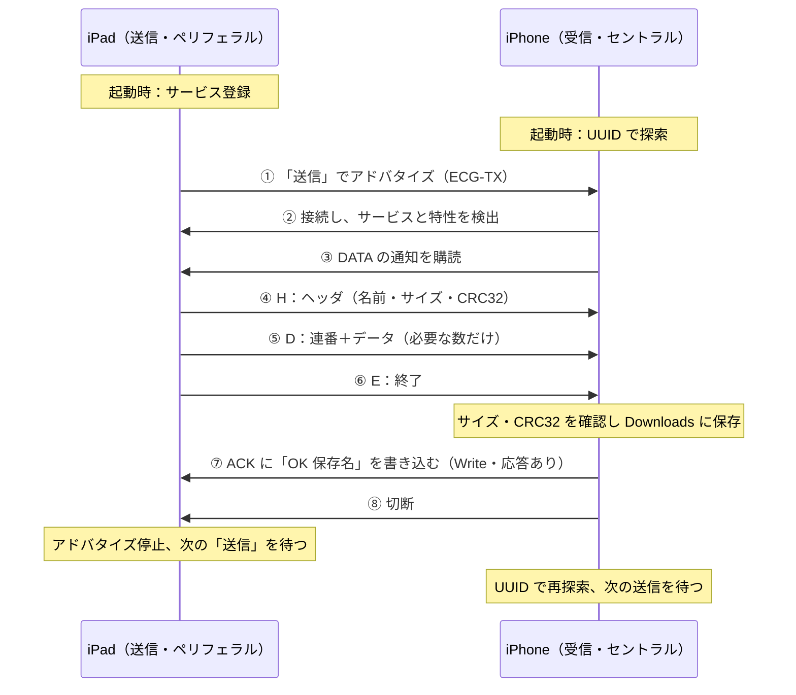

# ECG CSV 転送 iPad → iPhone（BLE / Pythonista 3）

iPad で選んだ心電図 CSV（例：`ECGtsHDdata1.csv`）を、Bluetooth Low Energy（BLE）で iPhone に送り、
iPhone で波形を表示します。Wi-Fi・IP アドレス・端末名の設定は要りません。

| 端末 | スクリプト | 役割 | BLE の役割 |
|------|-----------|------|-----------|
| iPad（送信） | `ecg_sender_ipad.py` | CSV を選んで 4行ヘッダ形式にそろえて送る | ペリフェラル（`CBPeripheralManager`） |
| iPhone（受信） | `ecg_viewer_iphone.py` | 受信して保存し、波形・異常検知を表示する | セントラル（`CBCentralManager`） |

どちらも **ファイル1つで動きます**（BLE の共通部分 `ecg_ble_section.py` を埋め込み済み）。
動作確認済みの版：**2026-10-25 r17**（起動時に画面へ表示されます）。

## 準備（最初に1回）

1. iPad・iPhone の両方に Pythonista 3 を入れ、Bluetooth をオンにする
2. スクリプトを **Pythonista 自身のフォルダー** に置く
   - iPad：`ecg_sender_ipad.py` を「ファイル」アプリで **このiPad内 > Pythonista 3** に移動
   - iPhone：`ecg_viewer_iphone.py` を **このiPhone内 > Pythonista 3** に移動
   - 「ファイル」アプリから直接開いて実行しないでください（画面左上に「◀ファイル」と出る開き方）。
     この開き方では同じフォルダーへの書き込みができず、正しく動きません
3. 初回の起動時に Bluetooth の使用許可を求められたら「許可」する
4. iPad に送る CSV を置いておく（「ファイル」アプリの「ダウンロード」など、どこでも選べます）

## 使い方

1. **iPhone**：Pythonista で `ecg_viewer_iphone.py` を開いて ▶
   - 「BLE 受信待機中（iPad の「送信」を待っています）」と出れば準備完了。画面はそのまま前面に出しておく
2. **iPad**：Pythonista で `ecg_sender_ipad.py` を開いて ▶
   - 約 3 秒後に BLE が始まり、「BLE の準備ができました」と出るまで待つ
3. **iPad**：「① CSVを選ぶ」で CSV を選ぶ
   - 3行目（電極状態）・4行目（不整脈の件数）は解析結果が入ります。必要なら書き換えられます
4. **iPad**：「② 送信（BLE）」を押す
   - iPhone が自動で接続し、送信中…% が進みます
5. 終わると
   - iPad：「送信しました。iPhone 側の保存名: …」→ 次の「送信」を待つ状態に戻る
   - iPhone：「受信完了（N 件目）」→ 「データ検出」になり、横向きにすると波形を表示。自動で次の受信を待つ
6. 続けて送るときは、iPad で ①・② をくり返すだけです（どちらのスクリプトも起動し直す必要はありません）
7. 終えるときは、iPad は「閉じる」、iPhone は右上の「×」を押します

転送中は両方の端末で Pythonista を前面に出したままにしてください（バックグラウンドに回ると BLE が止まります）。

### 受信したファイルの場所（iPhone）

「ファイル」アプリの **このiPhone内 > Pythonista 3 > Downloads**。同じ名前のファイルがあるときは上書きします。
iPhone の「ファイル」ボタンからは、AirDrop などで受け取った CSV を直接開くこともできます。

## CSV の形式

| 行 | 内容 |
|----|------|
| 1 | `ECG` |
| 2 | サンプル周波数（256） |
| 3 | 電極状態（0＝正常） |
| 4 | 不整脈の件数（0＝なし） |
| 5〜 | 心電データ |

元ファイルが2行ヘッダ（`ECG`／`256` の直後から心電データ）の場合は、iPad が波形を解析して3・4行目を作って送ります。

## うまくいかないとき

| 症状 | 確認すること |
|------|-------------|
| iPhone が iPad を見つけない | iPad で「BLE の準備ができました」と出てから「② 送信」を押したか。両方の Bluetooth がオンか。Pythonista が前面か |
| 「Bluetooth が許可されていません」 | 「設定」アプリ > Pythonista > Bluetooth をオン |
| 120 秒たって「iPhone が見つかりませんでした」 | iPhone で `ecg_viewer_iphone.py` が起動しているか |
| Pythonista が落ちた | もう一度同じスクリプトを起動すると、画面に「前回の動作記録」「前回落ちた時の Python の位置」が出ます。そのスクリーンショットを開発者へ送ってください（仕様 8.3） |

動作記録は、スクリプトと同じフォルダー（書き込めない場合は Pythonista の Documents）に次の名前で残ります。
消しても動作に影響はありません。

- `ecg_ble_trace_sender.txt` / `ecg_ble_trace_receiver.txt`（今回の記録。前回分は `_prev.txt`）
- `ecg_ble_fault_sender.txt` / `ecg_ble_fault_receiver.txt`（iOS の中で落ちた時の Python の位置）

## 仕様（版 2026-10-25 r17）

### 1. 概要

心電データ（256 Hz）の CSV を、Wi-Fi やネットワーク設定なしで iPad から iPhone へ送り、その場で波形と異常を確認するためのアプリです。iPhone はサービス UUID で iPad を自動で見つけて接続します。

| 項目 | 内容 |
| --- | --- |
| 送信側 | iPad（`ecg_sender_ipad.py`）／BLE ペリフェラル |
| 受信・表示側 | iPhone（`ecg_viewer_iphone.py`）／BLE セントラル |
| 実行環境 | Pythonista 3.4（Python 3.10.4）、iOS / iPadOS の Bluetooth をオン |
| 外部ライブラリ | なし（Pythonista 標準の `ui`・`dialogs`・`console`・`objc_util` と CoreBluetooth） |
| 対象ファイル | 心電 CSV（例：`ECGtsHDdata1.csv`）、1 ファイル最大 20 MB |
| 通信 | BLE の Notify（iPad → iPhone）と Write（iPhone → iPad の受信結果） |
| 保管場所 | GitHub `HIdeo-Okano/ai-camera-app` の `pythonista/ecg_ble/`、Google Drive「Pytest」フォルダー |

### 2. 画面と操作

操作は iPad の「① CSVを選ぶ」と「② 送信（BLE）」の 2 つだけで、iPhone は起動しておけば自動で受信・表示します。

#### 2.1 iPad 送信画面（全画面）

| 部品 | 動き |
| --- | --- |
| ① CSVを選ぶ（ダウンロード） | 「ファイル」の選択画面を開く。選んだ CSV を読み込み、波形を解析する |
| ファイル情報 | ファイル名、ヘッダ形式、秒数・点数、解析結果（電極はがれ区間数・不整脈件数） |
| 3行目 電極状態（0＝正常） | 送る CSV の 3 行目。元ファイルの値か解析結果が入る。書き換え可（0 以上の整数） |
| 4行目 不整脈の件数（0＝なし） | 送る CSV の 4 行目。同上 |
| ② 送信（BLE） | 送信を始める。終わるまでボタンは押せない（半透明） |
| 記録欄 | 進み具合（接続・送信中…%・結果）を下に追加していく |
| 閉じる | BLE を片付けてスクリプトを終える |

起動すると前回の動作記録を表示し、約 3 秒後に BLE を始めます。「BLE の準備ができました」が出たら送信できます。

#### 2.2 iPhone ビューア（縦向き）

| 部品 | 動き |
| --- | --- |
| データ検出の枠 | 受信前は灰色「データ未検出」、受信後は緑色「データ検出」。ファイル名・秒数・ヘッダ値を表示 |
| 電極状態／不整脈検知／心拍/分 | 3 つの値を表示。異常は赤・橙、正常は緑 |
| ファイル／ダミー／ダミー（電極はがれ） | 保存済み CSV を開く、または確認用の合成波形（20 秒／30 秒）を表示 |
| 共有／クリア | 表示中の CSV を共有シート（AirDrop など）で渡す／表示を消す |
| 横向きの案内 | データがあるとき「iPhoneを横向きにしてください」 |
| 受信の記録 | BLE の進み具合を直近 4 件表示 |
| × | 受信を止めて終える |

#### 2.3 iPhone ビューア（横向き）

- 上段：「データ検出」「電極 正常／はがれ」のバッジ、ファイル名・秒数、ダミー／はがれ／ファイルのボタン
- 波形：心電図用紙の格子（細線 0.2 秒・太線 1 秒）、R 波の印と R-R（ms）、電極はがれ区間の網掛け。印の色は通常＝緑・早期拍＝橙・休止＝青・電極はがれ＝灰
- 右のパネル：判定（規則的／不整脈の疑い／判定不可）、拍数・心拍/分・異常判定数、異常検知の一覧（最大 4 件）、拍ごとの時刻・R-R・判定の一覧
- 拍の一覧の行をタップすると、波形上にその拍の位置を点線で示す

### 3. CSV の読み込みと送信形式

iPad は必ず上の「CSV の形式」（4 行ヘッダ）にそろえて送ります。元ファイルは 4 行ヘッダ、2 行ヘッダ、ヘッダなしのどれでも読めます。

- 元ファイルが 2 行ヘッダ（`ECG`／`256` の直後から心電データ）なら、iPad が波形を解析して 3・4 行目を作る（3 行目＝電極はがれ区間の数、4 行目＝早期拍・休止の数）
- 自動判別：3・4 行目が 0〜9999 の整数なら 4 行ヘッダ、そうでなければ 2 行ヘッダとみなす
- `ECG,256` の 1 行ヘッダ、区切りの `,`・タブ・`;`、先頭の BOM にも対応
- 256 点（1 秒）未満は「サンプルが少なすぎます」で読み込み失敗
- 256 Hz 以外は線形補間で 256 Hz にそろえてから解析する

### 4. BLE 通信仕様

iPad がサービスを 1 つ公開し、ファイルは DATA の Notify で送り、受信結果は iPhone が ACK へ書き込みます。

#### 4.1 サービスとキャラクタリスティック

| 名前 | UUID | 向き | 性質／権限 | 用途 |
| --- | --- | --- | --- | --- |
| サービス | `8F1D0001-2C5A-4E7B-9A63-5E0C6A1B2D01` | — | プライマリ | iPhone はこの UUID だけで iPad を探す |
| DATA | `8F1D0002-2C5A-4E7B-9A63-5E0C6A1B2D01` | iPad → iPhone | Notify（0x10）／Readable（0x01） | ファイルデータ（1 通知＝1 パケット） |
| ACK | `8F1D0003-2C5A-4E7B-9A63-5E0C6A1B2D01` | iPhone → iPad | Write（0x08）／Writeable（0x02） | 受信結果（応答ありの書き込み） |

アドバタイズには名前 `ECG-TX` とサービス UUID を載せます。アドバタイズするのは「送信」を押してから送信が終わるまでです。

#### 4.2 パケット形式

1 パケットの最大長は iPhone が受け取れる長さ（`maximumUpdateValueLength`、例 182 バイト）です。

| 種類 | 中身 | 個数 |
| --- | --- | --- |
| ヘッダ | `H` + JSON `{"name","size","crc","fmt"}`（UTF-8、空白なし） | 1 |
| データ | `D` + 連番（4 バイト、ビッグエンディアン、0 から）+ データ（最大長 − 5 バイト） | サイズに応じて |
| 終了 | `E` | 1 |

- `size` はバイト数、`crc` は CRC32、`fmt` はヘッダ形式（送信時は `"4"`）
- ヘッダが 1 通知に収まらないときはファイル名を後ろから短くする。最大長が 16 バイト未満なら送信しない
- 送信待ちがいっぱい（`updateValue` が失敗）のときは、iOS の「送信できる」通知を待って続きから送る

#### 4.3 受信側の確認と応答

| 確認 | 失敗時の応答 |
| --- | --- |
| サイズが 1 バイト〜20 MB | `NG サイズが不正です` |
| ヘッダより前にデータが来ない | `NG ヘッダを受け取る前にデータが届きました` |
| 連番が 0, 1, 2 … と続く | `NG データの順番が不正です` |
| 受け取った量が宣言を超えない・一致する | `NG サイズが一致しません` |
| CRC32 が一致する | `NG CRC が一致しません（データ破損）` |
| 保存できる | `NG 保存に失敗 …` |

すべて通ると `OK <保存名>` を返します。応答は UTF-8 で最大 180 バイトです。保存先は iPhone の `~/Documents/Downloads`（ファイルアプリ：このiPhone内 > Pythonista 3 > Downloads）で、同名ファイルは上書きします。ファイル名から `\ / : * ? " < > |` を除き、拡張子が `.csv`・`.txt` でなければ `.csv` を付けます。

### 5. 送受信の流れ



④〜⑥は iPad が待ちなしで続けて送り、⑦の OK を受け取ったら送信成功です。iPhone が先に接続して待っている場合は①〜③を飛ばして④から始めます。

### 6. 待ち時間・エラー処理

待ち時間は 2 つで、どちらも失敗したら自動で次の送受信を待つ状態に戻ります。

| 待ち時間 | 値 | 対象 | 超えたとき |
| --- | --- | --- | --- |
| 送信の待ち時間（`SEND_TIMEOUT`） | 120 秒 | iPad：「送信」から iPhone の受信結果が届くまで | 送信失敗にしてアドバタイズを止め、ボタンを戻す |
| 接続の待ち時間（`CONNECT_TIMEOUT`） | 15 秒 | iPhone：接続を始めてから iPad のサービスが見つかるまで | 接続を切って探し直す |

| 画面のメッセージ | 端末 | 意味・対処 |
| --- | --- | --- |
| 「iPhone が見つかりませんでした（120 秒）」 | iPad | iPhone で `ecg_viewer_iphone.py` が動いていない。起動してもう一度送信 |
| 「iPhone から受信の確認が届きませんでした」 | iPad | 送信後に応答がない。もう一度送信 |
| 「送信の途中で iPhone との接続が切れました」 | iPad | 離れすぎ・画面が切り替わったなど。もう一度送信 |
| 「送信に失敗: NG …」 | iPad | iPhone が受信を拒否（4.3 の確認）。理由が続けて出る |
| 「Bluetooth: 許可されていません」 | 両方 | 設定 → Pythonista → Bluetooth をオン |
| 「Bluetooth: オフ」 | 両方 | 設定アプリで Bluetooth をオン |
| 「iPad から応答がないため、探し直します」 | iPhone | 接続の待ち時間切れ。自動で再試行 |
| 「… は送信の準備ができていません」 | iPhone | iPad で `ecg_sender_ipad.py` が動いていない |
| 「受信の途中で iPad との接続が切れました」 | iPhone | 途中までのデータを捨て、次の送信を待つ |
| 「BLE エラー: …」 | 両方 | プログラム内の予期しないエラー。画面とコンソールに内容を出し、動作は続ける |

Pythonista が落ちた場合は、同じスクリプトをもう一度起動すると、「前回の動作記録」と「前回落ちた時の Python の位置」が画面に出ます（8.3）。

### 7. 波形解析

iPad（送る前の 3・4 行目の計算）と iPhone（表示）は同じ解析を使います。整数演算で、`rr_detect.c` と同じ結果になります。

#### 7.1 R 波検出と不整脈判定

1. 2 点前との差の絶対値（上限 65535）を 16 点分足した値を作る
2. 最初の 2 秒（512 点）で、信号の強さ（最大の半分）と雑音の強さ（平均）を決める
3. しきい値 ＝ 雑音 + (信号 − 雑音) ÷ 4。山がしきい値を超え、前の R 波から 51 点（約 200 ms）以上離れていれば R 波
4. 信号・雑音の強さは山ごとに 1/8 ずつ追従させる
5. 直前 8 拍の R-R の中央値と比べて判定する（8 拍たまるまでは「履歴不足」）

| 判定 | 条件 | 表示色 |
| --- | --- | --- |
| 通常 | 下のどちらでもない | 緑 |
| 早期拍 | R-R ＜ 中央値 × 0.8 | 橙 |
| 休止 | R-R ＞ 中央値 × 1.3 | 青 |

心拍/分 ＝ 60 × 256 ÷ R-R の平均（点）です。R-R（ms）＝ R-R（点）× 1000 ÷ 256 で表示します。

#### 7.2 電極はがれ検出

波形を 0.5 秒（128 点）ごとに区切って調べます。

| 種類 | 条件 |
| --- | --- |
| 平坦 | 振幅（最大 − 最小）が 30 未満の区切りが 4 つ（2 秒）以上続く |
| 飽和 | 絶対値が 30000 以上の区切りが 2 つ（1 秒）以上続く |

はがれ区間とその前後 0.5 秒の拍、および区間直後の最初の R-R は「保留（電極）」とし、不整脈判定と心拍数から除きます。

#### 7.3 iPhone の表示の決め方

| 項目 | 優先順 |
| --- | --- |
| 電極状態 | CSV 3 行目が 0 以外 →「異常」。次に解析ではがれあり →「はがれ」（最後 0.6 秒以内にかかるとき）または「はがれ有」。どちらもなければ「正常」 |
| 不整脈検知 | CSV 4 行目の件数。なければ解析の早期拍・休止の数。8 拍未満なら「判定不可」 |
| 判定（横向き） | 判定できた拍がない →「判定不可」、早期拍・休止あり →「不整脈の疑い」、それ以外 →「規則的」 |

### 8. 内部設計

Pythonista 3.4 で落ちないように、iPad は BLE の操作を専用の作業スレッドにまとめ、CoreBluetooth は型を固定した関数で直接呼びます。

#### 8.1 スレッド構成

| スレッド | iPad（送信） | iPhone（受信） |
| --- | --- | --- |
| スクリプト | 画面を出し、閉じるまで `threading.Event().wait()` で待つ | 同左 |
| メイン（画面） | ボタン操作、0.2 秒ごとの `update()` で記録・結果を画面に出す。iOS からの通知は値を取り出して作業スレッドへ渡すだけ | CoreBluetooth の操作と通知の処理をすべてここで行う（予約は `ui.delay`） |
| BLE 作業（`ECGBleSender`） | CoreBluetooth の操作（サービス登録・アドバタイズ・送信）をすべて行う。0.5 秒ごとに待ち時間も確かめる | なし |
| ファイル選択 | 選択画面を出し、選ばれたパスを `update()` に渡す | 選択画面を出す |

iPad の画面は他のスレッドから `ui.delay` を使いません（予約したスレッドが終わった後に落ちたため）。iPhone のリクエストへの応答（`respondToRequest`）は、要求が有効な通知の中で返します。

#### 8.2 CoreBluetooth の呼び出し方

- Pythonista の `cb` モジュールは使わない（セントラル専用で、書き込みが `PY_SSIZE_T_CLEAN` エラーになる）
- `_send(obj, sel, sig, *args)` が、呼び出しの型ごとに専用の `objc_msgSend` を ctypes で作って呼ぶ。型の記号は `@` ポインタ・`B` BOOL・`q` 整数・`Q` 符号なし整数・`*` C 文字列・`v` なし
- `objc_util` はデリゲートのクラス作成（`create_objc_class`）と `load_framework` だけに使う（共有の `objc_msgSend` の型設定が書き換わり、ArgumentError や強制終了になったため）
- デリゲートの関数はモジュール直下に置き、動作中の送信側／受信側を `_ACTIVE` から探して呼ぶ（入れ子の関数は iPad で NameError）
- オブジェクトの参照は自分で持つ：iPad は登録したサービス・特性・接続中の iPhone を、iPhone は接続中の iPad と特性を、閉じるか切断するまで retain する

#### 8.3 動作記録

| ファイル | 中身 |
| --- | --- |
| `ecg_ble_trace_sender.txt`／`ecg_ble_trace_receiver.txt` | 処理ごとの記録（1 行ごとに保存）。前回分は `_prev.txt` |
| `ecg_ble_fault_sender.txt`／`ecg_ble_fault_receiver.txt` | iOS の中で落ちたときの全スレッドの Python の位置（faulthandler） |

保存先はスクリプトと同じフォルダーで、書き込めなければ Pythonista の Documents です。起動時に前回の記録の最後 25 行と落ちた位置を画面に出してから、3 秒後に BLE を始めます。

### 9. 制限事項

- 転送中は両方の端末で Pythonista を前面に出したままにする（バックグラウンドでは BLE が止まる）
- 1 回の送信で送れるのは 1 ファイル、1 台の iPhone まで。ファイルは最大 20 MB
- iPhone で同じ名前のファイルを受け取ると上書きする
- 通信はペアリング・暗号化をしていない。近くで同じプログラムを動かしている端末は受け取れるので、個人の心電データを扱う場合は注意する
- 調査用の動作記録を処理ごとに保存しているため、その分だけ処理が遅くなる
- 転送速度は未測定（受信側の最大長と iOS の送信待ちによる）
- 波形解析は確認用の簡易判定で、診断には使わない

### 10. テスト

| 種類 | 内容 | 結果 |
| --- | --- | --- |
| 自動テスト（PC） | `python3 test_ecg_ble.py`：実際の CSV の往復、小さい最大長、データ破損の NG、危険なファイル名、模擬 CoreBluetooth での一連の流れ・終了処理・2 回連続送信・待ち時間切れ、作業スレッドでの実行、動作記録、型ごとの呼び出し | 18 件すべて成功 |
| 実機診断 | `ble_diag_ipad.py`：BLE の準備 12 段と iPhone の接続 | すべて OK |
| 実機転送 | iPad → iPhone で CSV を送り、波形表示と終了処理を確認 | 問題なく転送 |

### 11. 改訂履歴

Wi-Fi（TCP）版を BLE に置き換え、r17 で実機転送が完成しました。履歴は新しい順です。

| 版 | 主な変更 |
| --- | --- |
| r17 | iPad の CoreBluetooth 操作を専用の作業スレッドに移す（iPhone 接続時に落ちる問題を解消）。iPad 画面を `update()` で更新。落ちた位置の記録（faulthandler） |
| r16 | 動作記録を書けないときは Documents に保存。起動診断を追加 |
| r15 | 動作記録をスクリプトの隣に置き、BLE 開始前に前回分を表示 |
| r14 | 起動時に前回の動作記録を表示。ObjC の呼び出しをすべて記録 |
| r13 | 登録したサービス・特性を手放さず保持 |
| r12 | CoreBluetooth を型固定の専用 `objc_msgSend` で呼ぶ（ArgumentError 対策） |
| r11 | `objc_util` をメインスレッドだけで使う |
| r10 | 落ちた場所を調べる動作記録を追加 |
| r9 | iPhone の名前による探索をやめ、サービス UUID だけで探す |
| r8 | 送信の待ち時間をメインスレッドで予約 |
| r7 | 転送後の終了処理を両端末で定義（iPhone は切断して次を待つ、iPad はアドバタイズを止める） |
| r6 | デリゲートをモジュール直下の関数にする（NameError 対策） |
| 初版 | Wi-Fi（TCP）の送受信を BLE に置き換え |

## 開発用ファイル

| ファイル | 内容 |
|---------|------|
| `ecg_ble_section.py` | BLE の共通部分（両方のスクリプトに同じものを埋め込む） |
| `test_ecg_ble.py` | PC 用のテスト（CoreBluetooth を模擬して送受信・終了処理・作業スレッドを確認） |
| `ble_diag_ipad.py` | iPad の BLE 診断（準備を1段ずつ行い、iPhone の接続を待つ） |
| `ble_diag_sender_start.py` | iPad 送信プログラムの起動診断 |

```sh
cd pythonista/ecg_ble
python3 test_ecg_ble.py [ECGtsHDdata1.csv のパス]
```

旧版（iPhone → iPad 方向の `pythonista/ble_csv_transfer/`）は削除しました。必要なら Git の履歴から取り出せます。
